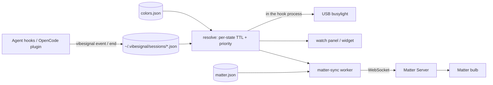

<div align="center">

# VibeSignal (Matter + OpenCode fork)

**An ambient status light for AI coding agents: Claude Code, Codex, and OpenCode.
Drive a USB busylight, an on-screen widget, or a Matter smart bulb.**

[](LICENSE)
[](https://www.python.org)
[](#limitations)

[What it does](#what-it-does) · [Install](#install) · [Setup paths](#choose-a-setup-path) · [Colors & themes](#colors-themes-and-brightness) · [How it works](#how-it-works) · [Troubleshooting](#troubleshooting) · [Contributing](#contributing)

</div>

> [!NOTE]
> This is a fork of **[VibeSignal](https://github.com/yzhao062/vibesignal)** by
> [Yue Zhao](https://github.com/yzhao062). The hook layer, session store, priority
> resolver, USB light support, terminal panel, and floating widget are upstream work.
> This fork adds Matter smart-bulb support, an OpenCode plugin, and configurable
> colors and themes. `pip install vibesignal` installs the **upstream** package, which
> has none of these additions; install from this checkout instead (see [Install](#install)).

## What it does

When you run several coding agents at once, the agent that needs you is usually in a
terminal you aren't looking at. Desktop notifications pile up and are easy to ignore.
VibeSignal puts the answer in your peripheral vision: one light shows the most urgent
state across every live session.

| State | Default color | Meaning |
|---|---|---|
| `blocked` | 🔴 red `#DC2626` | An agent is waiting on you (permission prompt or question) |
| `error` | 🟣 violet `#9333EA` | A session failed |
| `done` | 🔵 blue `#005AFF` | An agent finished its turn; your move |
| `working` | 🟢 green `#00C83C` | Agents are busy; leave them alone |
| `idle` | off | Nothing live |

With several sessions, the highest priority wins: **`blocked > error > done > working > idle`**.
If one agent is blocked while four others work, the light is red.

### What this fork adds

- **Matter smart bulb.** A small persistent worker mirrors the aggregate state to any
  Matter Extended Color Light through a local [matter.js Matter Server](https://github.com/matter-js/matterjs-server)
  (pinned in `matter-server/package.json`).
  Hooks never talk to the bulb, so they stay fast, and the worker turns the bulb off
  when sessions expire even if no further hook fires.
- **OpenCode.** `install-hooks --agent opencode` installs a dependency-free global
  OpenCode plugin. Delegated sub-agent sessions are ignored so they can't override
  their parent chat. Codex also gets `SessionEnd`, so a closed chat clears at once.
- **Configurable colors and themes.** Change any state color, apply a built-in theme
  (default, calm, warm, cool), and share mappings as small versioned JSON files. The
  USB light, widget, and bulb all read the same mapping.
- **Constant bulb brightness.** One brightness setting for every active state. State
  and theme changes only change hue and saturation.

## Install

Requirements: **Python 3.11+**. The Matter path also needs **Node.js 22.13+**
(for the pinned `matter-server` 1.4.0 runtime).

Clone this repository, then install it in editable mode from the checkout. Editable
mode matters for Matter: `install-matter-autostart` runs the Node runtime from the
checkout's `matter-server/` directory.

```bash
git clone <this-repository-url> vibesignal
cd vibesignal
python3 -m venv .venv
.venv/bin/pip install -e '.[matter]'
```

Optional extras: `macos` (native widget placement and always-on-top behavior) and
`dev` (pytest). Combine them as needed, for example `-e '.[matter,macos,dev]'`.
With [uv](https://docs.astral.sh/uv/):

```bash
uv venv .venv --python 3.11
uv pip install --python .venv/bin/python -e '.[matter,macos,dev]'
```

The commands below write `vibesignal`; use `.venv/bin/vibesignal` if the venv isn't
activated. `install-hooks` pins the absolute path of the `vibesignal` you run it with,
so the agents find this install even when their hook shell has a different `PATH`.

## Choose a setup path

Every path starts with the agent hooks; the renderers are independent and can be
combined.

### 1. Agent hooks (required)

```bash
vibesignal install-hooks                    # Claude Code -> ~/.claude/settings.json
vibesignal install-hooks --agent codex      # Codex       -> ~/.codex/hooks.json
vibesignal install-hooks --agent opencode   # OpenCode    -> ~/.config/opencode/plugins/vibesignal.js
```

Existing hooks are preserved, and re-running is idempotent (it also re-pins the path
after you move or recreate the venv). Then:

- **Claude Code:** takes effect in the next session.
- **Codex:** trust the new hooks once via `/hooks`, then restart Codex.
- **OpenCode:** restart OpenCode so it loads the plugin.

| Agent | `working` | `blocked` | `done` | `error` | session closed |
|---|---|---|---|---|---|
| Claude Code | `UserPromptSubmit`, `PostToolUse` | `Notification` (`permission_prompt`) | `Stop`, `StopFailure`, `Notification` (`idle_prompt`) | manual only | `SessionEnd` |
| Codex | `UserPromptSubmit`, `PostToolUse` | `PermissionRequest` | `Stop` | manual only | `SessionEnd` |
| OpenCode | `session.status` busy, permission/question replied | `permission.asked`, `question.asked` | `session.idle` | `session.error` | `session.deleted` |

Remove hooks with `vibesignal uninstall-hooks [--agent codex|opencode]`. To wire
Claude Code or Codex by hand, see [`hooks/`](hooks/) and
[`hooks/codex-hooks.md`](hooks/codex-hooks.md).

Check that events arrive without any hardware:

```bash
vibesignal event --agent claude --state blocked --session demo
vibesignal status        # aggregate state, color, per-session rows, Matter status
vibesignal clear         # forget all sessions
```

### 2. USB busylight

Plug in a light supported by [`busylight-core`](https://pypi.org/project/busylight-core/)
(for example Luxafor Flag or blink(1)). There is nothing else to configure: every hook
event sets the light directly and exits. With no light connected, hooks still record
state and exit cleanly. USB support is unchanged upstream functionality and has not
been re-tested on hardware in this fork.

### 3. Screen widget or terminal panel

```bash
vibesignal widget &              # always-on-top floating panel (macOS / Linux)
pythonw -m vibesignal widget     # Windows, no console window
vibesignal watch                 # live table in a terminal pane
```

On macOS and Windows, `vibesignal install-launcher` adds a launcher (Spotlight `.app`
or Start menu and Desktop shortcuts) and `vibesignal install-autostart` starts the
widget at login. On Linux, add a `~/.config/autostart/` entry that runs
`vibesignal widget`. The widget takes on the blocked or error color when any session
needs you, and right-click (or Control-click) quits it.

### 4. Matter smart bulb (macOS)

You need a Matter-over-Wi-Fi color bulb, the Mac and bulb on the same LAN/subnet
(Matter discovery is link-local), and an existing Matter controller (for example
Apple Home) to provide a sharing code.

**Install the runtime and start the services.** This installs two launchd agents: the
Matter Server (local only, `127.0.0.1:5580`) and the `matter-sync` worker. Both start
now and at every login and are restarted if they exit.

```bash
npm install --prefix matter-server
vibesignal install-matter-autostart --interface en0   # your primary network interface
```

**Commission the bulb.** On macOS the standalone server cannot commission over
Bluetooth, so add the bulb to Apple Home first, choose *Turn On Pairing Mode* in the
accessory's settings, then commission the already-networked bulb into VibeSignal's
fabric:

```bash
vibesignal matter-commission          # prompts for the sharing code without echoing it
vibesignal matter-nodes               # confirm the node is listed
vibesignal matter-config --brightness 15
vibesignal status                     # "matter: color=... error=none"
```

`matter-commission` selects the new node (endpoint 1 by default; pass `--endpoint` if
your bulb uses another). To select an existing node instead, run
`vibesignal matter-config --node <id> --endpoint <n>`. The Matter dashboard is at
<http://127.0.0.1:5580>.

Manage the services:

```bash
launchctl kickstart -k gui/$(id -u)/io.github.yzhao062.vibesignal.matter-sync     # restart the worker
launchctl kickstart -k gui/$(id -u)/io.github.yzhao062.vibesignal.matter-server   # restart the server
vibesignal uninstall-matter-autostart
```

Logs go to `~/.vibesignal/io.github.yzhao062.vibesignal.matter-{server,sync}.{log,err}`.

On Linux the Matter path has not been tested. In principle you can run the server
(`node matter-server/node_modules/matter-server/dist/esm/MatterServer.js --storage-path ~/.vibesignal/matter-server --listen-address 127.0.0.1`)
and `vibesignal matter-sync` under your own service manager.

## Colors, themes, and brightness

Colors apply to every renderer: the USB light, the widget, and the Matter bulb. `idle`
is always off and can't be assigned a color. `vibesignal config` with no option shows
the effective settings.

### Individual colors

```bash
vibesignal config --show
vibesignal config --color working '#00C83C'
vibesignal config --color blocked '#FF4400' --color done '#0088FF'   # several at once
vibesignal config --reset-colors
```

States are `working`, `blocked`, `done`, and `error`. Colors are 6-digit hex, with or
without `#` (quote them in the shell). Changing one state keeps the others. Unknown
states, malformed hex, and `#000000` are rejected with an explanation, and nothing is
changed. Black is rejected because a bulb takes only hue and saturation from a color,
so black would light up white.

### Themes

```bash
vibesignal config --list-themes
vibesignal config --theme calm
vibesignal config --color error '#C026D3'   # individual overrides still work afterward
```

A theme writes all four colors in one atomic update. `--show` reports the theme name
while the mapping matches it exactly, and `custom` after an override.

<p align="center"></p>

| Theme | `working` | `blocked` | `done` | `error` |
|---|---|---|---|---|
| `default` | `#00C83C` green | `#DC2626` red | `#005AFF` blue | `#9333EA` violet |
| `calm` | `#6DBE8C` sage | `#E07A72` coral | `#6F9EE0` soft blue | `#A88BDB` lavender |
| `warm` | `#E8C000` gold | `#DB1F4A` rose red | `#F2661B` orange | `#A3179E` magenta |
| `cool` | `#14B8A6` teal | `#EC4899` pink | `#3B82F6` blue | `#8B5CF6` indigo |

In every theme, the four states are at least 25° apart in hue and keep enough
saturation to read as distinct colors on a bulb. `warm` is the tightest, because
gold and orange sit close together.

### Import and export

```bash
vibesignal config --export-colors ./desk-colors.json
vibesignal config --import-colors ./desk-colors.json
```

Exports contain the effective colors, including individual overrides:

```json
{
  "schema_version": 1,
  "colors": {
    "working": "#00C83C",
    "blocked": "#DC2626",
    "done": "#005AFF",
    "error": "#9333EA"
  }
}
```

An import must include `schema_version: 1` and all four states. VibeSignal validates
the whole file before applying it. An unsupported version, an extra key, an unknown
state, `idle`, or an invalid color rejects the file and leaves the current colors
untouched. Files contain only colors: imports and themes never change brightness or
Matter connection settings.

### Bulb brightness

```bash
vibesignal matter-config --brightness 12
```

`--brightness` is a whole-number percentage from 1 to 100. Every active state uses the
same level. The level comes only from this setting, never from how light or dark a
state's color is, so state and theme changes alter hue and saturation only. Idle
turns the bulb off. A fresh install defaults to 100%; most people will want something
much lower on a desk.

`matter-config` changes only the flags you pass. The others are `--url`, `--node`,
`--clear-node`, `--endpoint`, and `--transition` (in tenths of a second, default 3).

### Where settings live and when they apply

Everything lives in `~/.vibesignal/` (override with `VIBECODING_SIGNAL_DIR`):

| Path | Contents |
|---|---|
| `colors.json` | Color mapping, same format as an export (absent means defaults) |
| `matter.json` | Matter server URL, node, endpoint, transition, brightness |
| `sessions/` | One small JSON file per live agent session |
| `matter_status.json`, `last_color.json` | Last applied colors and Matter errors, for `status` |
| `matter-server/` | Matter fabric storage, **including pairing credentials; never share it** |

Changes apply live:

- **Matter worker:** re-reads `colors.json` and `matter.json` about twice a second, so
  color, theme, import, and brightness changes reach the bulb without a restart.
- **Widget:** picks up color changes on its next refresh (about one second).
- **USB light:** `vibesignal config` re-applies the light immediately. Otherwise it
  changes on the next hook event.
- **Terminal panel (`watch`):** uses fixed basic ANSI colors that approximate the
  default hues, because 24-bit color isn't reliable across terminals.

### Upgrading from the pulse version

Earlier builds of this fork used `max_brightness_pct`, `steady_brightness_pct`, and
`priority_pulse_seconds` (a brief peak on priority increases). These were replaced by
the single `brightness_pct`, and old files are migrated when read:

1. A valid `brightness_pct` is used as is.
2. Otherwise, a valid steady brightness is kept, capped at the old maximum.
3. Otherwise, the old maximum is used (100 if absent).
4. Pulse settings are ignored.

For example, max 20 / steady 12 / pulse 0.6 becomes 12%. Server URL, node, endpoint,
transition, and unknown keys are preserved. The file is rewritten in the new format
the next time you run `vibesignal matter-config` (with or without flags). The
migration is repeatable and doesn't depend on that rewrite. The old
`--max-brightness`, `--steady-brightness`, and `--priority-pulse-seconds` flags are
gone.

> [!IMPORTANT]
> After upgrading, restart the running worker (`launchctl kickstart -k gui/$(id -u)/io.github.yzhao062.vibesignal.matter-sync`).
> A worker still running the old code doesn't understand `brightness_pct`. Once
> `matter.json` has been rewritten, the old worker would fall back to 100%.

## How it works



- **Hooks are short-lived.** Each event atomically writes one per-session file, resolves
  the aggregate under a bounded cross-process lock, sets the USB light if the color
  changed, and exits. A VibeSignal failure never fails the agent's hook.
- **One worker owns the bulb.** Network I/O stays out of hooks. `matter-sync` polls the
  store, and when the resolved (color, config) pair changes it sends a Level Control
  command (`moveToLevelWithOnOff`, from the brightness setting) and a Color Control
  command (`moveToHueAndSaturation`, from the state color), or `off` for idle. Failed
  sends are retried every 5 seconds and reported by `vibesignal status`.
- **Lifetimes.** Hooks only refresh a session when something happens, so each state
  expires on its own clock: `done` after 90 s, `error` after 5 min, silent `working`
  after 10 min, and `blocked` at an 8 h crash backstop. A state change, a session-end
  event, or `vibesignal clear` removes it sooner. Expiry is computed at read time, so
  the worker turns the bulb off on expiry without any new event.
- **Colors are separate from logic.** State names, aliases (`needs_input` → `blocked`),
  priorities, and lifetimes live in `resolve.py`. `colors.py` maps states to colors and
  is read tolerantly: a corrupt `colors.json` falls back to defaults per state.

See [DESIGN.md](DESIGN.md) for the design history and rationale.

## Tested with

| Component | Tested |
|---|---|
| Matter bulb | Linkind ST19 (AiDot) Matter-over-Wi-Fi color bulb, first commissioned in Apple Home |
| Matter host | macOS with launchd, Node.js 22, `matter-server` 1.4.0 |
| Agents | Claude Code, Codex, OpenCode |
| Core, widget, installers | Upstream CI on Windows, macOS, and Linux, Python 3.11–3.13 |
| USB lights | Upstream support through `busylight-core`; not re-tested in this fork |

Other Matter color bulbs should work if they expose the standard On/Off, Level Control,
and Color Control (hue/saturation) clusters. Reports are welcome.

## Troubleshooting

| Symptom | Check |
|---|---|
| Nothing changes | Run `vibesignal status` while an agent works. No sessions means the hooks aren't firing: re-run `install-hooks`, restart the agent, and for Codex trust them via `/hooks`. |
| `status` shows `matter: ... error=...` | The worker can't reach the server or bulb. Check the server log in `~/.vibesignal/`, open <http://127.0.0.1:5580>, and run `vibesignal matter-nodes`. |
| Commissioning times out | The Mac and bulb must be on the same subnet. Use a fresh sharing code from Apple Home. Check `--interface` (`en0` is usually Wi-Fi on laptops). |
| Bulb is wrong after a power cut or manual change | The worker only sends on changes. Restart it (`launchctl kickstart -k …matter-sync`) to re-apply now. |
| Bulb too bright or dim | `vibesignal matter-config --brightness N`, applied live. |
| Colors look different on the bulb | Bulbs render hue and saturation with their own LEDs. Adjust per state with `config --color`. |
| A stale session pins the light | `vibesignal clear` (all) or `vibesignal clear --session <id>`. |
| `colors.json` edited by hand and ignored | `vibesignal config --show` prints a warning naming the problem. |

## Limitations

This is an experimental personal project shared for feedback:

- Matter autostart is macOS-only (launchd). The Matter path is tested with one bulb
  model.
- The worker doesn't notice when the bulb is power-cycled or changed from another app
  until the next state change or a worker restart.
- Hue accuracy depends on the bulb. Pastel (low-saturation) colors look whiter on some
  bulbs.
- The OpenCode plugin depends on OpenCode's event names, which may change between
  releases.
- `error` is detected automatically only for OpenCode (`session.error`). For Claude Code
  and Codex, set it manually with `vibesignal event --agent <name> --state error`.
- One aggregate light per bulb. There is no per-session multi-bulb or LED-strip mapping
  yet.

## Development

```bash
.venv/bin/pip install -e '.[matter,dev]'
.venv/bin/python -m pytest -q
```

Tests mock all Matter I/O and USB devices and run against a temporary state directory,
so they never touch your real `~/.vibesignal` or bulb. The Tk widget render test skips
when no Tk display is available.

Layout: `store.py` (session files, atomic writes) · `resolve.py` (states, priority,
lifetimes) · `colors.py` (color mapping, themes, import/export) · `light.py` (USB) ·
`matter.py` (Matter client and worker) · `panel.py` / `widget.py` (screen renderers) ·
`installer.py` (hooks, launchers, autostart) · `__main__.py` (CLI).

## Contributing

Feedback and collaboration are welcome, especially:

- results with other Matter bulbs (model, firmware, and how each theme looks),
- Linux or Windows service setups for the Matter worker,
- agent integrations and hook mappings for other tools,
- better palettes. Keep the four states clearly distinguishable on real hardware.

Please open an issue on this repository with your setup and `vibesignal status`
output (it contains no credentials). Pull requests should include tests (`pytest -q`
passes) and keep hooks fast and non-blocking. Ideas that fit upstream VibeSignal
itself are best proposed [upstream](https://github.com/yzhao062/vibesignal).

## Credits and license

VibeSignal was created by [Yue Zhao](https://github.com/yzhao062)
([upstream repository](https://github.com/yzhao062/vibesignal)). This fork's additions
are distributed under the same terms.

[BSD 2-Clause](LICENSE) © 2026 Yue Zhao
