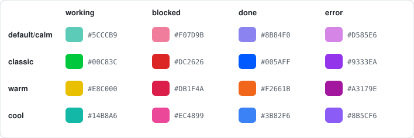
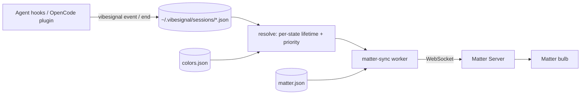

<div align="center">

# VibeSignal for Matter

**Turn a Matter smart bulb into an ambient status light for your AI coding agents:
Claude Code, Codex, and OpenCode.**

[](https://github.com/noahyoungs/vibesignal/actions/workflows/ci.yml)
[](LICENSE)
[](https://www.python.org)
[](#limitations)

[What it does](#what-it-does) · [Install](#install) · [Set up the bulb](#set-up-the-bulb) · [Connect your agents](#connect-your-agents) · [Colors & themes](#colors-themes-and-brightness) · [Troubleshooting](#troubleshooting) · [Contributing](#contributing)

</div>

> [!NOTE]
> This is a Matter-focused fork of **[VibeSignal](https://github.com/yzhao062/vibesignal)**
> by [Yue Zhao](https://github.com/yzhao062), which drives USB busylights and an
> on-screen widget. If you want one of those instead of a smart bulb, use
> [upstream VibeSignal](https://github.com/yzhao062/vibesignal). This fork keeps that
> support too (see [Other displays](#other-displays)).

## What it does

When you run several coding agents at once, the one that needs you is usually in a
terminal you aren't looking at, and desktop notifications are easy to ignore. VibeSignal
puts the answer in your peripheral vision: a smart bulb on your desk shows the most
urgent state across every live agent session.

| State | Default color | Meaning |
|---|---|---|
| `blocked` | dawn rose `#F07D9B` | An agent is waiting on you (permission prompt or question) |
| `error` | night orchid `#D585E6` | A session failed |
| `done` | night periwinkle `#8B84F0` | An agent finished its turn; your move |
| `working` | ocean teal `#5CCCB9` | Agents are busy; leave them alone |
| `idle` | off | Nothing live |

With several sessions, the highest priority wins: **`blocked > error > done > working > idle`**.
If one agent is blocked while four others work, the bulb is rose.

The default palette is the calm one, after the calm-chords project: each color keeps
the hue of a calm-chords tone (ocean screen `#a8fff0`, dawn rose `#f7b7c8`, deep-night
screen `#c8c4ff`, deep-night chord hue 290) with its saturation deepened just enough
for a bulb. It is soft on screen but still reads clearly on a bulb; see
[What the bulb receives](#what-the-bulb-receives). The original vivid
green/red/blue/violet set is the `classic` theme.

Highlights:

- **Any Matter color bulb**, driven through a local [matter.js Matter Server](https://github.com/matter-js/matterjs-server)
  (pinned in `matter-server/package.json`). One small worker owns the bulb, so agent
  hooks stay fast, and the bulb turns off by itself when sessions expire.
- **Claude Code, Codex, and OpenCode** (1.x and 2.x, including OpenChamber), installed
  with one command each. Sub-agent sessions can't override their parent chat.
- **Colors and themes:** change any state color, pick a built-in theme (default/calm,
  classic, warm, cool), and share mappings as small JSON files.
- **Constant brightness:** one brightness level for every state. State and theme changes
  only change the hue.

## Install

Requirements: **macOS**, **Python 3.11+**, and **Node.js 22.13+** (for the pinned
`matter-server` 1.4.0 runtime).

Clone the repository and install it in editable mode. The Matter services run the Node
runtime from the checkout's `matter-server/` directory, so keep the checkout where it is.

```bash
git clone https://github.com/noahyoungs/vibesignal.git vibesignal
cd vibesignal
python3 -m venv .venv
.venv/bin/pip install -e '.[matter]'
npm install --prefix matter-server
```

With [uv](https://docs.astral.sh/uv/), replace the last three lines with:

```bash
uv venv .venv --python 3.11
uv pip install --python .venv/bin/python -e '.[matter]'
npm install --prefix matter-server
```

The package is named `vibesignal-matter` so it can't be confused with upstream's
`vibesignal` on PyPI; the command and Python module are still `vibesignal`. If upstream
is installed in the same environment, `pip uninstall vibesignal` first.

The commands below write `vibesignal`; use `.venv/bin/vibesignal` if the venv isn't
activated.

## Set up the bulb

You need a Matter-over-Wi-Fi color bulb, the Mac and bulb on the same LAN/subnet
(Matter discovery is link-local), and an existing Matter controller (for example Apple
Home) to provide a sharing code.

**1. Start the services.** This installs two launchd agents: the Matter Server (local
only, `127.0.0.1:5580`) and the `matter-sync` worker that drives the bulb. Both start
now and at every login, and restart if they exit.

```bash
vibesignal install-matter-autostart --interface en0   # your primary network interface
```

**2. Commission the bulb.** On macOS the standalone server can't commission over
Bluetooth, so add the bulb to Apple Home first, choose *Turn On Pairing Mode* in the
accessory's settings, then commission the already-networked bulb into VibeSignal's
fabric:

```bash
vibesignal matter-commission          # prompts for the sharing code without echoing it
vibesignal matter-nodes               # confirm the node is listed
```

`matter-commission` selects the new node (endpoint 1 by default; pass `--endpoint` if
your bulb uses another). To select an existing node instead, run
`vibesignal matter-config --node <id> --endpoint <n>`. The Matter dashboard is at
<http://127.0.0.1:5580>.

**3. Set a comfortable brightness** (a fresh install uses 100%):

```bash
vibesignal matter-config --brightness 15
```

**4. Check it.** This fakes a blocked agent, so the bulb should turn rose within a
second, and off again after the clear:

```bash
vibesignal event --agent claude --state blocked --session demo
vibesignal status        # aggregate state, per-session rows, "matter: ... error=none"
vibesignal clear
```

Manage the services:

```bash
launchctl kickstart -k gui/$(id -u)/io.github.yzhao062.vibesignal.matter-sync     # restart the worker
launchctl kickstart -k gui/$(id -u)/io.github.yzhao062.vibesignal.matter-server   # restart the server
vibesignal uninstall-matter-autostart
```

Logs go to `~/.vibesignal/io.github.yzhao062.vibesignal.matter-{server,sync}.{log,err}`.

On Linux the Matter path hasn't been tested. In principle you can run the server
(`node matter-server/node_modules/matter-server/dist/esm/MatterServer.js --storage-path ~/.vibesignal/matter-server --listen-address 127.0.0.1`)
and `vibesignal matter-sync` under your own service manager.

## Connect your agents

```bash
vibesignal install-hooks                    # Claude Code -> ~/.claude/settings.json
vibesignal install-hooks --agent codex      # Codex       -> ~/.codex/hooks.json
vibesignal install-hooks --agent opencode   # OpenCode    -> ~/.config/opencode/plugins/vibesignal.js
```

Existing hooks are preserved, and re-running is safe. `install-hooks` pins the absolute
path of the `vibesignal` you run it with, so agents find it even when their hook shell
has a different `PATH`; re-run it if you move or recreate the venv. Then:

- **Claude Code:** takes effect in the next session.
- **Codex:** trust the new hooks once via `/hooks`, then restart Codex.
- **OpenCode / OpenChamber:** restart it so it loads the plugin.

| Agent | `working` | `blocked` | `done` | `error` | session closed |
|---|---|---|---|---|---|
| Claude Code | `UserPromptSubmit`, `PostToolUse` | `Notification` (`permission_prompt`) | `Stop`, `StopFailure`, `Notification` (`idle_prompt`), a denied permission prompt¹ | manual only | `SessionEnd` |
| Codex | `UserPromptSubmit`, `PostToolUse` | `PermissionRequest` | `Stop` | manual only | `SessionEnd` |
| OpenCode 1.x | `session.status` busy, permission/question replied | `permission.asked`, `question.asked` | `session.idle` | `session.error` | `session.deleted` |
| OpenCode 2.x (OpenChamber) | `session.execution.started`, permission replied/rejected | `permission.asked` | `session.execution.succeeded`/`interrupted` | `session.execution.failed`, `session.error` | `session.deleted` |

¹ Claude Code fires no hook when you deny a permission prompt; the turn just ends.
VibeSignal keeps the session's transcript path and, while a session is `blocked`,
treats a turn end recorded in the transcript after the block as `done`.

Remove hooks with `vibesignal uninstall-hooks [--agent codex|opencode]`. To wire
Claude Code or Codex by hand, see [`hooks/`](hooks/) and
[`hooks/codex-hooks.md`](hooks/codex-hooks.md).

## Colors, themes, and brightness

`vibesignal config` with no option shows the effective settings. `idle` is always off
and can't be assigned a color.

### Individual colors

```bash
vibesignal config --show
vibesignal config --color working '#5CCCB9'
vibesignal config --color blocked '#FF4400' --color done '#0088FF'   # several at once
vibesignal config --reset-colors
```

States are `working`, `blocked`, `done`, and `error`. Colors are 6-digit hex, with or
without `#` (quote them in the shell). Changing one state keeps the others. Unknown
states, malformed hex, and `#000000` are rejected with an explanation, and nothing is
changed. Black is rejected because a bulb takes only hue and saturation from a color,
so black would light up white.

### Themes

```bash
vibesignal config --list-themes
vibesignal config --theme classic
vibesignal config --color error '#C026D3'   # individual overrides still work afterward
```

A theme writes all four colors in one atomic update. `--show` reports the theme name
while the mapping matches it exactly, and `custom` after an override.

<p align="center"></p>

| Theme | `working` | `blocked` | `done` | `error` |
|---|---|---|---|---|
| `default` / `calm` | `#5CCCB9` ocean teal | `#F07D9B` dawn rose | `#8B84F0` night periwinkle | `#D585E6` night orchid |
| `classic` | `#00C83C` green | `#DC2626` red | `#005AFF` blue | `#9333EA` violet |
| `warm` | `#E8C000` gold | `#DB1F4A` rose red | `#F2661B` orange | `#A3179E` magenta |
| `cool` | `#14B8A6` teal | `#EC4899` pink | `#3B82F6` blue | `#8B5CF6` indigo |

`calm` is the same mapping as `default` (so `--show` reports it as `default`), and
`classic` holds the vivid colors that were the default before. In every theme, the four
states are at least 25° apart in hue and keep enough saturation to read as distinct
colors on a bulb. `warm` is the tightest, because gold and orange sit close together.

### What the bulb receives

A Matter bulb takes only hue and saturation from a color (`moveToHueAndSaturation`,
both 0-254). The level comes only from `--brightness`, so a theme never changes
brightness. The calm default keeps `working`, `blocked`, and `done` at least 60° apart
in hue, `error` at least 30° from `blocked`, and every saturation at 0.35 or above, so
the bulb never washes out to white. A unit test enforces these limits.

| State | Old default (now `classic`) | Bulb hue / sat | New default (calm) | Bulb hue / sat |
|---|---|---|---|---|
| `working` | `#00C83C` green (138°) | 97 / 254 | `#5CCCB9` ocean teal (170°) | 120 / 139 |
| `blocked` | `#DC2626` red (0°) | 0 / 210 | `#F07D9B` dawn rose (344°) | 243 / 122 |
| `done` | `#005AFF` blue (219°) | 154 / 254 | `#8B84F0` night periwinkle (244°) | 172 / 114 |
| `error` | `#9333EA` violet (271°) | 192 / 199 | `#D585E6` night orchid (290°) | 204 / 107 |

Lower saturation makes the bulb look softer, closer to pastel. If your bulb renders the
calm colors too pale, `vibesignal config --theme classic` restores the vivid set.

### Import and export

```bash
vibesignal config --export-colors ./desk-colors.json
vibesignal config --import-colors ./desk-colors.json
```

Exports contain the effective colors, including individual overrides:

```json
{
  "schema_version": 1,
  "colors": {
    "working": "#5CCCB9",
    "blocked": "#F07D9B",
    "done": "#8B84F0",
    "error": "#D585E6"
  }
}
```

An import must include `schema_version: 1` and all four states. VibeSignal validates
the whole file before applying it. An unsupported version, an extra key, an unknown
state, `idle`, or an invalid color rejects the file and leaves the current colors
untouched. Files contain only colors: imports and themes never change brightness or
Matter connection settings.

### Brightness

```bash
vibesignal matter-config --brightness 12
```

`--brightness` is a whole-number percentage from 1 to 100. Every active state uses the
same level. The level comes only from this setting, never from how light or dark a
state's color is, so state and theme changes alter hue and saturation only. Idle turns
the bulb off.

`matter-config` changes only the flags you pass. The others are `--url`, `--node`,
`--clear-node`, `--endpoint`, and `--transition` (in tenths of a second, default 3).

### Where settings live

Everything lives in `~/.vibesignal/` (override with `VIBECODING_SIGNAL_DIR`):

| Path | Contents |
|---|---|
| `colors.json` | Color mapping, same format as an export (absent means defaults) |
| `matter.json` | Matter server URL, node, endpoint, transition, brightness |
| `sessions/` | One small JSON file per live agent session |
| `matter_status.json` | Last color sent to the bulb and any Matter error, for `status` |
| `matter-server/` | Matter fabric storage, **including pairing credentials; never share it** |

The worker re-reads `colors.json` and `matter.json` about twice a second, so color,
theme, import, and brightness changes reach the bulb without a restart.

## How it works



- **Hooks are short-lived.** Each agent event atomically writes one per-session file
  under a bounded cross-process lock and exits. A VibeSignal failure never fails the
  agent's hook.
- **One worker owns the bulb.** Network I/O stays out of hooks. `matter-sync` polls the
  store, and when the resolved (color, config) pair changes it sends a Level Control
  command (`moveToLevelWithOnOff`, from the brightness setting) and a Color Control
  command (`moveToHueAndSaturation`, from the state color), or `off` for idle. Failed
  sends are retried every 5 seconds and reported by `vibesignal status`.
- **Lifetimes.** Hooks only refresh a session when something happens, so each state
  expires on its own clock: `done` after 90 s, `error` after 5 min, silent `working`
  after 10 min, and `blocked` at an 8 h crash backstop. A state change, a session-end
  event, or `vibesignal clear` removes it sooner. Expiry is computed at read time, so
  the worker turns the bulb off on expiry without any new event.

See [DESIGN.md](DESIGN.md) for the design history and rationale.

## Other displays

Everything from upstream VibeSignal still works in this fork and follows the same colors:

- **USB busylights** supported by [`busylight-core`](https://pypi.org/project/busylight-core/)
  (for example Luxafor Flag or blink(1)) are set directly by every hook event.
- **On-screen widget:** `vibesignal widget &` (add the `macos` extra on macOS), plus
  `install-launcher` and `install-autostart`. A small deep-night card with a rounded
  status screen; when an agent needs you, the whole card takes the `blocked` color.
  A static mockup of the working, needs-you, and done states is in
  [`docs/widget-mockup.html`](docs/widget-mockup.html).
- **Terminal panel:** `vibesignal watch`.

They aren't the focus here and haven't been re-tested in this fork. If you don't have a
Matter bulb, [upstream VibeSignal](https://github.com/yzhao062/vibesignal) documents
them in full and is the better starting point.

## Tested with

| Component | Tested |
|---|---|
| Matter bulb | Linkind ST19 (AiDot) Matter-over-Wi-Fi color bulb, first commissioned in Apple Home |
| Matter host | macOS with launchd, Node.js 22, `matter-server` 1.4.0 |
| Agents | Claude Code 2.1, Codex 0.151, OpenCode 1.18 and 2.0.18 (bundled by OpenChamber) |

Other Matter color bulbs should work if they expose the standard On/Off, Level Control,
and Color Control (hue/saturation) clusters. Reports are welcome.

## Troubleshooting

| Symptom | Check |
|---|---|
| Nothing changes | Run `vibesignal status` while an agent works. No sessions means the hooks aren't firing: re-run `install-hooks`, restart the agent, and for Codex trust them via `/hooks`. |
| `status` shows `matter: ... error=...` | The worker can't reach the server or bulb. Check the server log in `~/.vibesignal/`, open <http://127.0.0.1:5580>, and run `vibesignal matter-nodes`. |
| Commissioning times out | The Mac and bulb must be on the same subnet. Use a fresh sharing code from Apple Home. Check `--interface` (`en0` is usually Wi-Fi on laptops). |
| Bulb is wrong after a power cut or manual change | The worker only sends on changes. Restart it (`launchctl kickstart -k …matter-sync`) to re-apply now. |
| Bulb too bright or dim | `vibesignal matter-config --brightness N`, applied live. |
| Colors look different on the bulb | Bulbs render hue and saturation with their own LEDs. Adjust per state with `config --color`. |
| A stale session pins the light | `vibesignal clear` (all) or `vibesignal clear --session <id>`. |
| `colors.json` edited by hand and ignored | `vibesignal config --show` prints a warning naming the problem. |

## Limitations

This is an experimental personal project shared for feedback:

- Matter autostart is macOS-only (launchd). The Matter path is tested with one bulb
  model.
- The worker doesn't notice when the bulb is power-cycled or changed from another app
  until the next state change or a worker restart.
- Hue accuracy depends on the bulb. Pastel (low-saturation) colors look whiter on some
  bulbs.
- One OpenCode plugin file serves 1.x and 2.x. OpenCode 2.x's plugin API is new and
  undocumented, so event names may change; its `blocked` mapping (`permission.asked`)
  hasn't been verified live, and 2.x questions/forms aren't mapped yet.
- Detecting a denied Claude Code permission prompt relies on Claude's transcript
  format (a `system`/`turn_duration` entry), which isn't a documented interface.
- `error` is detected automatically only for OpenCode. For Claude Code and Codex, set it
  manually with `vibesignal event --agent <name> --state error`.
- One aggregate state per bulb. There's no per-session multi-bulb mapping yet.

## Development

```bash
.venv/bin/pip install -e '.[matter,dev]'
.venv/bin/python -m pytest -q
```

Tests mock all Matter I/O and USB devices and run against a temporary state directory,
so they never touch your real `~/.vibesignal` or bulb.

Layout: `matter.py` (Matter client and worker) · `colors.py` (color mapping, themes,
import/export) · `resolve.py` (states, priority, lifetimes) · `store.py` (session files,
atomic writes) · `installer.py` (hooks, OpenCode plugin, services) · `__main__.py`
(CLI) · `light.py` / `widget.py` / `panel.py` (upstream displays).

## Contributing

Feedback and collaboration are welcome, especially:

- results with other Matter bulbs (model, firmware, and how each theme looks),
- Linux or Windows service setups for the Matter worker,
- agent integrations and hook mappings for other tools,
- better palettes. Keep the four states clearly distinguishable on real hardware.

Please [open an issue](https://github.com/noahyoungs/vibesignal/issues) with your setup
and `vibesignal status` output (it contains no credentials). Pull requests should
include tests (`pytest -q` passes) and keep hooks fast and non-blocking. Improvements to
the USB light or widget are best proposed [upstream](https://github.com/yzhao062/vibesignal).

## Credits and license

VibeSignal was created by [Yue Zhao](https://github.com/yzhao062)
([upstream repository](https://github.com/yzhao062/vibesignal)). This fork's additions
by Noah Youngs are distributed under the same terms.

[BSD 2-Clause](LICENSE) © 2026 Yue Zhao; fork additions © 2026 Noah Youngs
